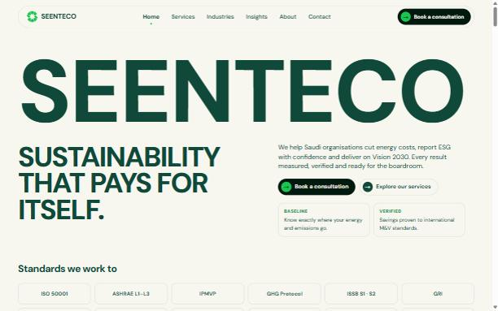
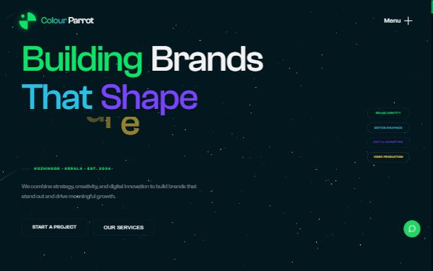

<div align="center">



<br/>

[](https://arshak-p.github.io/personal/)
[](https://www.linkedin.com/in/arshak-p/)
[](https://colourparrot.com/)

</div>

```js
const arshak = {
  role: "Full-stack developer",
  works: "with Colour Parrot Advertising LLP",
  builds: ["corporate websites", "animated brand sites", "e-commerce", "business web apps"],
  loves: ["clean UI", "smooth motion", "fast pages", "things that ship"],
  stack: ["React", "Next.js", "TypeScript", "Django", "PostgreSQL"],
  availableFor: "freelance and agency projects",
};
```


## ✨ What I can build for you

| 🌐 **Brand and corporate websites** | 🎬 **Animated, award-style sites** | 🛒 **E-commerce and web apps** |
|:--|:--|:--|
| Fast, responsive, SEO-ready sites in Next.js and React, from design to launch. | GSAP, Framer Motion, Three.js and silky smooth scrolling that make a brand feel alive. | Django + PostgreSQL back ends with React or HTML/CSS front ends: carts, dashboards, admin panels. |

## 🚀 Featured work

<table>
<tr>
<td width="50%" valign="top">
<a href="https://seenteco.com"></a>
<h3>Seenteco Consultancy</h3>
17-page corporate website for a Riyadh sustainability and energy consultancy: services, industries, FAQ, insights, contact form, preloader and page transitions.<br/>
<sub><b>Next.js · React · static export · PHP form</b></sub><br/>
<a href="https://seenteco.com">🔗 seenteco.com</a> · <i>code private (client work)</i>
</td>
<td width="50%" valign="top">
<a href="https://colourparrot.com"></a>
<h3>Colour Parrot Agency</h3>
Cinematic agency website with a starfield hero, GSAP animations, Three.js scenes and Lenis smooth scrolling.<br/>
<sub><b>React · Vite · GSAP · Three.js · Lenis</b></sub><br/>
<a href="https://colourparrot.com">🔗 colourparrot.com</a> · <a href="https://github.com/arshak-p/colourparrot-portfolio">💻 code</a>
</td>
</tr>
</table>

| Project | What it is | Stack |
|:--|:--|:--|
| [**FarWayGo Logistics**](https://github.com/arshak-p/FarWayGo-logistic) | Marketing website for a logistics company | Next.js 16, TypeScript, Tailwind, Framer Motion |
| [**Hospital Management**](https://github.com/arshak-p/hospital_mgt) | Role-based dashboards for admin, reception and billing *(in progress)* | Django |
| [**Inventory UI**](https://github.com/arshak-p/invetory_mgt) | Product list, product form and stock management screens | React, Vite, Tailwind |
| [**Personal portfolio**](https://arshak-p.github.io/personal/) | My own portfolio site, live on GitHub Pages | HTML, CSS, JavaScript |

## 🤝 Let's work together

Have a brand, a product or a client who needs a website that looks great and loads fast? **Message me on [LinkedIn](https://www.linkedin.com/in/arshak-p/)** and tell me what you have in mind.


